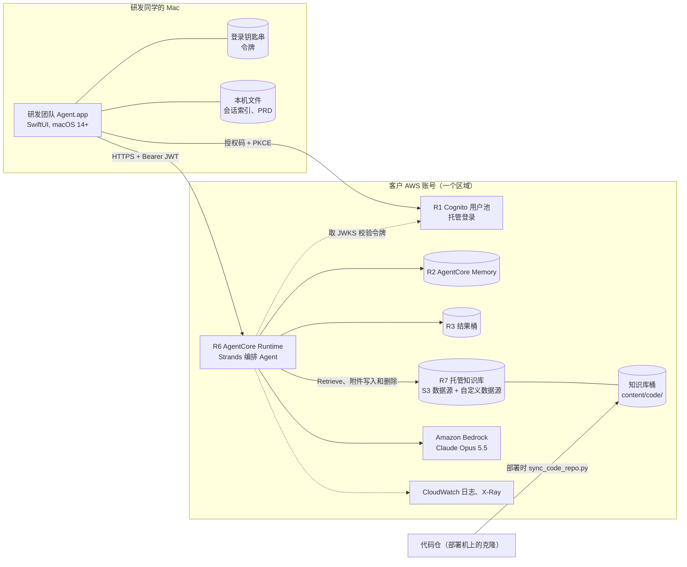
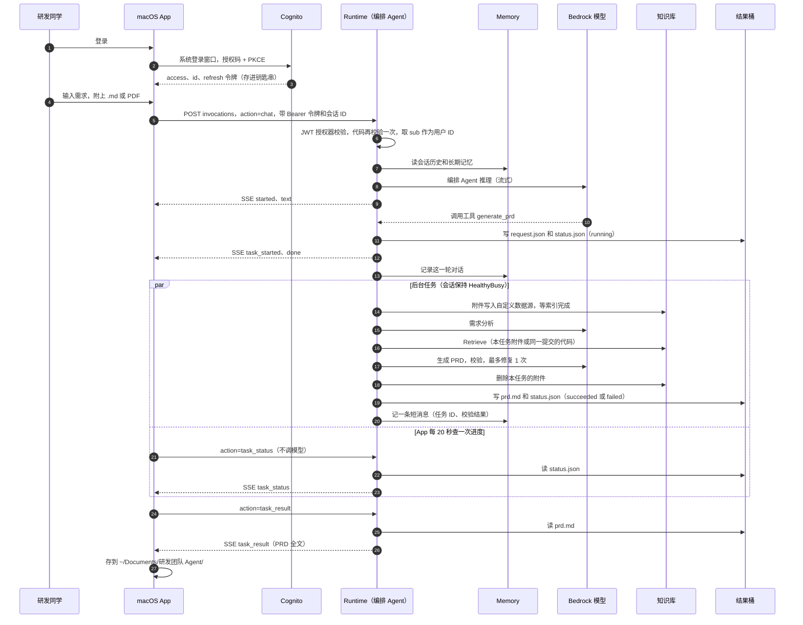

# 研发团队 Agent（rd-team-agent）

研发同学在 Mac 上通过对话使用的 Agent。第一版个能力：根据会话附件（`.md`、PDF）和一个代码仓某次提交的代码，在后台生成一份英文 PRD。

本文的读者有两类：接手这套代码的工程师，以及替他们在客户环境里部署、改造这套代码的 AI。

- 第 1-4 节：现状、架构、服务之间怎么调用、代码在哪里。
- 第 5 节：从零部署到一个 AWS 账号，并生成 DMG。按顺序执行即可。
- 第 6 节：针对客户环境要改的地方。每一项都写了默认值、什么时候要改、改哪个文件。全部不改也能跑通。
- 第 7-10 节：运维、排错、本地开发、已知限制。

设计取舍的来龙去脉见 [docs/architecture.md](docs/architecture.md)。那份文档写的是第一版的设计，其中「保存到 GitHub」（第 3 节步骤 ⑥ 和 4.5 节）还没有实现。两份文档不一致时，以本文和代码为准。

## 1. 当前状态

「已实测」指在演示用的 AWS 账号（us-east-1）里端到端跑过。

| 能力 | 状态 |
| --- | --- |
| 登录：Cognito 托管登录，授权码 + PKCE | 已实测 |
| 对话：流式回复；附件支持 `.md` 和 PDF，一次最多 20 份，提取后的文字共不超过 2 MB | 已实测 |
| 后台生成 PRD、查进度、取回结果并存到本机 | 已实测，一次 7-9 分钟 |
| 会话列表、历史消息、长期记忆（偏好、事实、会话摘要） | 已实测 |
| 删除会话（服务端真删）、失败任务一键重试 | 已实测 |
| 会话改名、分组 | 已实测，只存在本机 |
| 多用户隔离：每个人只能看到自己的会话、记忆和结果 | 已实测（3 个测试账号） |
| 把 PRD 保存到 GitHub 或 SharePoint（确认卡片 + 写入工具） | **未实现**，接入思路见 6.11 |
| 公司 IdP（Entra ID 或 Okta） | 未接入，现在用 Cognito 本地账号代替，见 6.3 |
| Gateway + Policy、审批服务、Jira 等其他工具 | 后期再做 |

## 2. 架构

### 2.1 组件



完整的架构图（含后期组件）见 [docs/architecture.drawio.svg](docs/architecture.drawio.svg)。

| 编号 | 组件 | 作用 | 由谁创建 / 代码 |
| --- | --- | --- | --- |
| R1 | Cognito 用户池 `rd-team-agent-users`、托管登录域名 `rd-team-agent-<账号>`、Mac client `rd-team-agent-mac`、CLI client `rd-team-agent-cli-test` | 签发 JWT。关闭自助注册。Mac client 不带密钥，只开授权码 + PKCE，回调地址 `rdteamagent://callback`。CLI client 只给冒烟测试用（用户名密码登录） | `server/scripts/deploy_orchestrator.py` |
| R2 | AgentCore Memory `rd_team_agent_memory` | 短期：按「用户 + 会话」存每条消息，保留 30 天。长期：偏好、语义事实、会话摘要三种策略 | 同上；读写在 `server/src/orchestrator/memory.py` |
| R3 | S3 桶 `rd-team-agent-results-<账号>-<区域>` | 每个任务的输入、状态和 PRD（`results/`），以及 Runtime 部署包（`runtime/`）。公共访问阻止全开、禁用 ACL、SSE-S3、只允许 TLS | 同上；读写在 `server/src/orchestrator/results.py` |
| R5 | IAM 角色 `rd-team-agent-<区域>-runtime` | Runtime 的执行角色，最小权限内联策略 `RdTeamAgentRuntime`，写入前先过 IAM Access Analyzer | `deploy_orchestrator.py` 的 `runtime_policy()` |
| R6 | AgentCore Runtime `rd_team_agent` | 跑编排 Agent。JWT 入站认证，网络模式 `PUBLIC`，Python 3.12 arm64 直接代码部署，把 `Authorization` 头转给代码 | `deploy_orchestrator.py`；代码在 `server/orchestrator_app.py`、`server/src/` |
| R7 | Bedrock 托管知识库 `<前缀>-kb` 和它的桶 `<前缀>-<账号>-<区域>` | S3 数据源 `<前缀>-s3` 放代码切块；自定义数据源 `<前缀>-custom` 放任务附件，每个任务写入、用完删除 | `server/scripts/provision_test_stack.py` 建，`sync_code_repo.py` 写代码 |
| - | Bedrock 模型 | 编排 Agent 和 PRD 生成都用 `us.anthropic.claude-opus-5-5` 推理配置 | 部署参数 `--model-id` |
| - | macOS App | 三栏：会话列表、对话、右栏（本次任务、附件、我的长期记忆） | `app/` |

docs/architecture.md 里的 R4（Identity 里的 GitHub 令牌）和 R9（PRD 文档库）属于还没实现的保存功能，部署时不会创建。R8 是演示用的示例代码仓，是另一个独立仓库，不在本仓库里。

### 2.2 编排 Agent 和 PRD 生成

- **编排 Agent**（`server/src/orchestrator/agent.py`）：Strands Agent，系统提示词在 `SYSTEM_PROMPT`。它先追问需求（一次最多 3 个问题），需求清楚并且有附件时调用 `generate_prd`。回复语言跟随用户。工具每次请求重新创建，绑定到这次请求的用户和会话，所以模型无法替别人建任务或查任务。
  - `generate_prd(requirement_text)`：启动后台任务，立即返回任务 ID。
  - `get_prd_status(task_id)`：查本会话里某个任务的状态。
- **PRD 生成流程**（`server/src/prd_agent/`，确定性流程，不是自由发挥的 Agent）：
  1. 附件整份写进知识库的自定义数据源，带 `task_id` 元数据，等到可检索（最长 300 秒）。
  2. 需求分析：把需求整理成结构化输入，并给出检索问题（最多 12 个）。
  3. 检索：过滤条件是「本任务的附件」或「同一项目、同一提交的代码」，满足其一即可。
  4. 生成：按 PRD 模板（`server/contracts/*.contract.json`）写出各章节和代码影响条目。
  5. 校验：检查章节结构、引用是否来自检索结果、代码影响里的文件是否在这次提交的文件清单里。不通过时最多修复 1 次。
  6. 删除本任务写进知识库的附件。
- PRD 固定是英文（模板的 `language` 只允许 `en-US`）。

### 2.3 代码目录

```text
rd-team-agent/
├── README.md                     本文
├── CONTEXT.md                    术语表
├── docs/                         设计文档、架构图和画图脚本
├── app/                          macOS App（Swift Package，无第三方依赖）
│   ├── Package.swift
│   ├── Sources/RDTeamAgentCore/  不含 UI 的逻辑：连接设置、登录、Runtime 客户端、附件、本机存储
│   ├── Sources/RDTeamAgentMac/   SwiftUI 界面和 AppModel
│   ├── Tests/                    52 个单元测试
│   ├── Resources/AppIcon.icns
│   └── scripts/build_dmg.sh      跑测试、构建 universal 二进制、组装 .app、打 DMG
└── server/                       服务端（Python 3.12）
    ├── orchestrator_app.py       Runtime 入口
    ├── src/orchestrator/         编排 Agent：认证、请求分发、工具、后台任务、Memory、结果桶、会话删除
    ├── src/prd_agent/            PRD 生成流程：需求分析、检索、生成、校验、模板、代码切块
    ├── contracts/                PRD 模板（当前是演示用的 mock 模板）
    ├── examples/                 演示用附件
    ├── scripts/
    │   ├── preflight.py          只读检查：账号、区域、模型能否调用
    │   ├── provision_test_stack.py  建知识库（R7）
    │   ├── sync_code_repo.py     把代码仓某次提交写进知识库
    │   ├── deploy_orchestrator.py   建 R1、R2、R3、R5、R6，构建并部署 Runtime
    │   └── smoke_orchestrator.py    部署后的端到端冒烟测试（由人执行）
    └── tests/                    234 个单元测试
```

`server/` 下还有一套早期的独立 PRD Agent（`server/app.py`、`deploy_runtime.py`、`invoke_runtime.py`、`one_click_deploy.sh`、`smoke_gateway.py`、`teardown_stack.py`、`update_gateway_target_filter.py`），它用 SigV4 认证、经 Gateway 检索。`server/README.md` 和 `server/AGENT_DEPLOYMENT_RUNBOOK.md` 描述的就是这一套。本项目只复用其中的 `provision_test_stack.py` 建知识库，`deploy_orchestrator.py` 会从 `deploy_runtime.py` 导入打包函数，其余脚本部署时用不到。

## 3. 服务之间如何调用

### 3.1 一次完整的使用过程



### 3.2 登录和身份

- **App 侧**（`app/Sources/RDTeamAgentCore/Auth.swift`）：用 `ASWebAuthenticationSession` 打开 `https://<托管登录域名>/oauth2/authorize`，回调 `rdteamagent://callback`，再到 `/oauth2/token` 换令牌。令牌存在登录钥匙串里。access 令牌 60 分钟有效，剩不到 5 分钟时 App 用 refresh 令牌（7 天有效）续期。续期返回 `invalid_grant` 时要求重新登录。退出登录时调 `/oauth2/revoke`。App 里没有任何 AWS 密钥。
- **Runtime 侧**：
  1. Runtime 的 JWT 授权器按 Cognito 的发现地址校验签名，只接受 `allowedClients` 里的 client（Mac client 和 CLI client）。
  2. 代码（`server/src/orchestrator/identity.py`）再校验一次：签名、issuer、过期时间、`token_use` 必须是 `access`、`client_id` 必须在环境变量 `ALLOWED_CLIENT_IDS` 里。这样即使授权器配错，代码也不会信任伪造的令牌。
  3. 用户 ID 只取校验过的 `sub`。请求体里没有任何字段能指定用户。

### 3.3 App 调 Runtime 的协议

所有请求都是同一个端点：

```text
POST https://bedrock-agentcore.<区域>.amazonaws.com/runtimes/<URL 编码后的 Runtime ARN>/invocations?qualifier=DEFAULT
Authorization: Bearer <Cognito access 令牌>
X-Amzn-Bedrock-AgentCore-Runtime-Session-Id: <会话 ID，33-100 个字符；App 用 rdta-<UUID>>
Content-Type: application/json
Accept: text/event-stream
```

- 响应是 SSE，每行 `data: {...}` 是一个 JSON 事件，`event` 字段说明类型。
- **会话 ID 同时是**：Runtime 会话 ID、Memory 的 `sessionId`、结果桶里的目录名。
- 列会话、看记忆这类不属于某个会话的请求，App 用每个用户固定的一个「工具会话 ID」发送。
- 请求体的 `action` 决定做什么（`server/src/orchestrator/app.py`）：

| action | 请求体其他字段 | 调模型 | 返回的事件 |
| --- | --- | --- | --- |
| `chat`（默认） | `message`（不超过 20000 字符）、`documents: [{path, content}]` | 是 | `started`、若干 `text`、可能有 `task_started`、最后 `done` |
| `list_sessions` | - | 否 | `sessions`：`sessions` 列表和 `deleted_session_ids` |
| `history` | - | 否 | `history`：`messages` |
| `list_memories` | - | 否 | `memories`：`records` |
| `task_status` | `task_id` | 否 | `task_status`：`task` |
| `task_result` | `task_id` | 否 | `task_result`：`task` 和 `prd_markdown` |
| `retry_task` | `task_id` | 否 | `task_started`：用保存的输入启动新任务 |
| `delete_session` | - | 否 | `session_deleted`：删掉的事件、摘要和结果对象数 |

- **请求出错**时返回 `{"event": "error", "error": {"code", "message"}}`：

| code | 含义 |
| --- | --- |
| `UNAUTHENTICATED` | 令牌缺失、无效、过期，或不是允许的 client 签发的 |
| `INVALID_SESSION` | 会话 ID 不合法 |
| `INVALID_REQUEST` | 请求体不对，或未知的 action |
| `INVALID_DOCUMENTS` | 附件超过数量或大小上限，或路径重复 |
| `NOT_FOUND` | 本会话里没有这个任务（别人的任务也返回这个） |
| `NOT_READY` | 任务还没成功，取不到 PRD |
| `NOT_RETRYABLE` | 这个任务不能重试 |
| `TASK_RUNNING` | 会话里还有任务在跑，不能删除 |
| `INTERNAL_ERROR` | 服务端异常，详情在 Runtime 日志里 |

- **任务状态**（`status.json` 的 `state`）：`running`、`succeeded`、`failed`。失败时 `error.code` 是以下之一：
  - `INVALID_DOCUMENTS`：附件被拒。不能重试。
  - `NEEDS_CLARIFICATION`：需求缺信息，`error.questions` 里有问题。不能重试，要在对话里补充。
  - `DOCUMENT_INDEXING_TIMEOUT`、`DOCUMENT_INDEXING_FAILED`：附件索引超时或失败。
  - `GENERATION_FAILED`：生成过程异常。
  - `RETRIEVAL_FAILED`、`FAILED_VALIDATION`、`INGESTION_FAILED`、`EVALUATION_UNAVAILABLE`：PRD 生成流程的结束状态，取值见 `server/src/prd_agent/contracts.py` 的 `RunStatus`。校验没通过时 `error.issues` 里有规则 ID。
  - `JOB_LOST`：任务超过 45 分钟还是 `running`，说明会话已经没了。
- **重试**：只有失败的任务能重试，每个任务只能重试一次。新任务的状态里有 `retried_from`，旧任务的状态里补上 `retried_as`。没有保存输入的旧任务不能重试，App 会提示重新附上文档。

### 3.4 后台任务和会话生命周期

- `generate_prd` 用 `bedrock-agentcore` SDK 的 `add_async_task` / `complete_async_task` 把生成放到后台（`server/src/orchestrator/jobs.py`）。任务运行期间会话处于 `HealthyBusy`，不会被回收。中途关掉 App 不影响生成。
- AgentCore 的限制：会话空闲 15 分钟销毁，最长存活 8 小时；后台任务最长 8 小时；流式连接最长 60 分钟。会话销毁后里面的东西全部清空，所以任务状态和结果都写在 S3，之后任何请求、任何新会话都能读到。
- 部署新版本后，已经存在的 Runtime 会话继续跑旧版本，直到它空闲 15 分钟被回收或被停止。

### 3.5 数据存在哪里

| 数据 | 位置 | 键或命名空间 | 保留 |
| --- | --- | --- | --- |
| 对话消息 | Memory 短期事件 | `actorId` = `sub`，`sessionId` = 会话 ID | 30 天 |
| 偏好、事实 | Memory 长期记录 | `/strategy/{策略 ID}/actor/{sub}/` | 一直保留；删会话时不删 |
| 会话摘要 | Memory 长期记录 | `/strategy/{策略 ID}/actor/{sub}/session/{会话 ID}/` | 删会话时一起删 |
| 任务输入、状态、PRD | 结果桶 | `results/<sub>/<会话 ID>/<任务 ID>/request.json`、`status.json`、`prd.md` | 没有生命周期规则；删会话时一起删 |
| 删除标记 | 结果桶 | `results/<sub>/_deleted/<会话 ID>` | 一直保留。Memory 删掉事件后仍会列出这个会话，靠它隐藏 |
| 代码切块 | 知识库桶 `content/code/`，经 S3 数据源索引 | 元数据 `project_id`、`commit_sha`、`file_path`、行号 | 手动维护 |
| 代码文件清单 | Runtime 部署包里的 `source-manifests/<哈希>.json` | 按项目、仓库、提交区分 | 跟随部署 |
| 任务附件 | 知识库自定义数据源 | 元数据 `task_id` | 任务结束就删 |
| 登录令牌 | Mac 登录钥匙串 | service `com.dengwj.rd-team-agent`，account `cognito-tokens` | 退出登录时删 |
| 会话索引（标题、分组、任务卡片） | `~/Library/Application Support/RDTeamAgent/<sub>/sessions.json` | | 本机 |
| PRD 文件 | `~/Documents/研发团队 Agent/` | `<会话标题>-<任务 ID 前 8 位>.md` | 本机 |
| 连接设置 | App 的 UserDefaults | | 本机 |

### 3.6 用户隔离靠什么

- 所有服务端读写都用校验过的 `sub` 拼路径或命名空间：结果桶的 `results/<sub>/`，Memory 的 `actorId`。用户 ID、会话 ID、任务 ID 都先按正则校验，再拼进 S3 键，调用方没法构造出别人的路径。
- App 不直接访问 S3、Memory 或知识库，只调 Runtime。所以不需要给每个用户单独配 AWS 权限。
- 任务附件带 `task_id` 写进知识库，检索只能命中本任务的附件。`task_id` 由服务端生成。

## 4. 部署前要知道的事

- 一套部署对应**一个区域、一个项目、一个代码仓的一次提交、一个 PRD 模板**。这些值在部署时写进 Runtime 的环境变量，换任何一个都要重新部署（见 7.1）。
- 部署脚本默认只读（dry-run），加 `--apply` 才会创建或修改资源。所有资源先按名字查找，已存在就更新，所以重复执行是安全的。
- 部署脚本**不删除任何资源**，仓库里也没有这套服务的清理脚本。
- 知识库、代码同步、编排服务是三步，必须在**同一份代码检出**里依次执行：`sync_code_repo.py` 把代码文件清单写到 `server/deploy/out/source-manifests/`，`deploy_orchestrator.py` 再把它打进部署包。`server/deploy/out/` 已加入 `.gitignore`，不含密钥，但要保留，后续更新要用。

## 5. 部署到客户环境

### 5.1 给执行部署的 AI 的规则

1. **先 dry-run，后 apply。** 每个带 `--apply` 的命令，先不带 `--apply` 跑一遍，把输出的计划交给人确认后再执行。
2. **不碰密钥。** 只用 `--profile` 指定的 AWS CLI profile。不读取、不打印、不保存 AK/SK、令牌、密码。用户密码、IdP 的 client secret、Apple 签名凭证都由人来输入。
3. **不删除资源。** 需要删除时，列出资源清单交给人决定。
4. **失败就停。** 报告步骤号、完整错误信息、日志位置和建议的下一步。不要为了让检查通过去放宽权限或跳过校验。
5. **改代码要先跑测试。** 服务端改动后跑 `server/` 的单元测试；App 改动后跑 `swift test`。`build_dmg.sh` 会先跑 App 测试，测试不过不出 DMG。
6. **按第 6 节决定改造项。** 开始前先拿着 6.0 的清单问人，再动手。

### 5.2 需要人提供的输入

| 变量 | 含义 | 示例 |
| --- | --- | --- |
| `PROFILE` | 已配置好的 AWS CLI profile | `rd-agent-deploy` |
| `ACCOUNT` | 12 位 AWS 账号 ID，每个脚本都会核对 | `123456789012` |
| `REGION` | 区域，必须有 Bedrock 托管知识库，见 6.1 | `us-east-1` |
| `MODEL_ID` | Bedrock 推理配置 ID，见 6.2 | `us.anthropic.claude-opus-5-5` |
| `PROJECT_ID` | 项目 ID，写在每个代码切块上 | `align-rd` |
| `REPO_NAME` | 代码仓名称，写在每个代码切块上 | `my-service` |
| `REPO_PATH` | 代码仓在部署机上的克隆路径（绝对路径） | `/Users/me/src/my-service` |
| `REPO_REV` | 要同步的分支、标签或提交 | `main` |
| `KB_PREFIX` | 知识库资源的名字前缀 | `rd-team-agent-kb` |
| 测试账号 | 冒烟测试用的 Cognito 用户名，逗号分隔 | `tester1,tester2` |

### 5.3 前置条件

**部署机**（macOS 或 Linux；生成 DMG 必须是 macOS）：

- `git`、AWS CLI v2、`jq`。
- [uv](https://docs.astral.sh/uv/)：用来建 Python 3.12 环境，并下载 linux/arm64 的依赖打进 Runtime 部署包。不需要 Docker。
- 能访问 PyPI。内网只有镜像时，设置 `UV_INDEX_URL` 和 `PIP_INDEX_URL` 指向镜像。
- 生成 DMG：macOS 14 以上，Xcode 或 Command Line Tools，Swift 6 工具链（`Package.swift` 要求 swift-tools 6.0）。我们用 macOS 26.7 + Swift 6.4 构建过。

**AWS 账号**：

- Bedrock 里已经开通所选模型。Anthropic 模型第一次使用要先在 Bedrock 控制台提交使用说明。第 2 步的 preflight 会做一次极小的模型调用来确认。
- 调用者的权限：沙箱账号里最简单的是 `AdministratorAccess`。要收紧的话，需要覆盖：
  - Cognito：创建和更新用户池、域名、app client，创建用户。
  - AgentCore 控制面：创建和更新 Memory、Runtime、Gateway、Gateway target。
  - Bedrock：创建知识库和数据源、启动摄取、`Retrieve`、`GetInferenceProfile`、`InvokeModel`。
  - S3：创建和配置两个桶，读写对象。
  - IAM：创建角色、写内联策略、打标签，以及对这些角色 `iam:PassRole`；IAM Access Analyzer 的 `ValidatePolicy`。
  - STS：`GetCallerIdentity`。
- 用临时凭证时，开始前剩余有效期至少 1 小时。凭证中途过期不会损坏环境，刷新后重跑同一条命令即可。

### 5.4 部署步骤

除非特别说明，命令都在 `server/` 目录里执行。

```bash
cd server
export PROFILE=<profile> ACCOUNT=<账号 ID> REGION=us-east-1
export MODEL_ID=us.anthropic.claude-opus-5-5
export PROJECT_ID=<项目 ID> REPO_NAME=<仓库名> REPO_PATH=<克隆路径> REPO_REV=main
export KB_PREFIX=rd-team-agent-kb
```

#### 第 1 步：建 Python 环境，跑测试

```bash
uv venv --python 3.12 .venv
uv pip install --python .venv/bin/python -r requirements.txt
PYTHONPATH=src .venv/bin/python -B -m unittest discover -s tests -p 'test_*.py'
```

成功标准：最后一行是 `OK`，共 234 个测试。

#### 第 2 步：只读检查

```bash
.venv/bin/python scripts/preflight.py --profile "$PROFILE" --region "$REGION" \
  --expected-account "$ACCOUNT" --model-family opus-5-5 --probe-model
```

成功标准：输出 JSON 里 `"passed": true`，退出码 0。它检查本机工具、账号、区域是否有托管知识库、推理配置是否可用、控制面 API 是否可达，并发起一次最多 32 个 token 的模型调用。

#### 第 3 步：建知识库（R7）

```bash
# dry-run：只打印计划
.venv/bin/python scripts/provision_test_stack.py --profile "$PROFILE" --region "$REGION" \
  --expected-account "$ACCOUNT" --prefix "$KB_PREFIX" --model-family opus-5-5

# 人确认后执行
.venv/bin/python scripts/provision_test_stack.py --profile "$PROFILE" --region "$REGION" \
  --expected-account "$ACCOUNT" --prefix "$KB_PREFIX" --model-family opus-5-5 \
  --apply --state-file deploy/out/kb-stack.json

export KB_ID=$(jq -r .knowledge_base_id deploy/out/kb-stack.json)
export CODE_DS_ID=$(jq -r .data_source_id deploy/out/kb-stack.json)
export TASK_DS_ID=$(jq -r .task_data_source_id deploy/out/kb-stack.json)
export KB_BUCKET=$(jq -r .bucket_name deploy/out/kb-stack.json)
```

成功标准：状态文件里 `knowledge_base_status` 是 `ACTIVE`，`ingestion_status` 是 `COMPLETE`，`task_data_source_status` 是 `AVAILABLE`。

说明：

- 这个脚本来自早期的独立 PRD Agent，除了知识库，还会建一个 Gateway、一个 Gateway target、3 个 IAM 角色，并上传一份 mock 文档和 mock 代码（`project_id` 为 `mock-prd-e2e`）。本项目只用到知识库、它的桶和两个数据源。多出来的资源不影响运行，因为检索按 `project_id` 过滤，mock 数据检索不到。
- 我们用默认前缀 `prd-agent-mock-e2e` 实测过。换成别的前缀时，桶名 `<前缀>-<账号>-<区域>` 不能超过 63 个字符。

#### 第 4 步：把代码仓同步进知识库

```bash
# dry-run：解析提交、切块，列出要上传的对象
.venv/bin/python scripts/sync_code_repo.py --profile "$PROFILE" --region "$REGION" \
  --repo "$REPO_PATH" --commit "$REPO_REV" --project-id "$PROJECT_ID" --repository-name "$REPO_NAME" \
  --bucket "$KB_BUCKET" --knowledge-base-id "$KB_ID" --data-source-id "$CODE_DS_ID"

# 人确认后执行
.venv/bin/python scripts/sync_code_repo.py --profile "$PROFILE" --region "$REGION" \
  --repo "$REPO_PATH" --commit "$REPO_REV" --project-id "$PROJECT_ID" --repository-name "$REPO_NAME" \
  --bucket "$KB_BUCKET" --knowledge-base-id "$KB_ID" --data-source-id "$CODE_DS_ID" --apply

export REPO_COMMIT=$(git -C "$REPO_PATH" rev-parse "$REPO_REV^{commit}")
```

成功标准：输出的 `result.retrieve_check` 不为空，`ingestion_statistics` 里失败文档数为 0；`deploy/out/source-manifests/` 下多了一个 JSON 文件。

说明：

- 代码取自提交本身（`git archive`），没提交的改动、`node_modules`、`.venv` 等不会进知识库。
- 支持的文件类型和排除规则见 `server/src/prd_agent/code_ingestion.py`：常见语言的源码以及 JSON、YAML、TOML、XML、SQL；跳过超过 1 MB 的文件、二进制文件、锁文件和 `node_modules`、`vendor`、`target` 等目录。
- 已经存在、内容不同的对象不会被覆盖，脚本会报错停下。

#### 第 5 步：部署编排服务（R1、R2、R3、R5、R6）

```bash
# dry-run
.venv/bin/python scripts/deploy_orchestrator.py --profile "$PROFILE" --region "$REGION" \
  --expected-account "$ACCOUNT" --model-id "$MODEL_ID" \
  --knowledge-base-id "$KB_ID" --task-data-source-id "$TASK_DS_ID" \
  --project-id "$PROJECT_ID" --repository-name "$REPO_NAME" --repository-commit "$REPO_COMMIT" \
  --test-users tester1,tester2

# 人确认后执行（uv 必须在 PATH 里）
.venv/bin/python scripts/deploy_orchestrator.py --profile "$PROFILE" --region "$REGION" \
  --expected-account "$ACCOUNT" --model-id "$MODEL_ID" \
  --knowledge-base-id "$KB_ID" --task-data-source-id "$TASK_DS_ID" \
  --project-id "$PROJECT_ID" --repository-name "$REPO_NAME" --repository-commit "$REPO_COMMIT" \
  --test-users tester1,tester2 --apply
```

它依次：建或更新 Cognito（R1）和测试用户、Memory（R2）、结果桶（R3）、执行角色（R5，先过 Access Analyzer）；用 uv 下载 arm64 依赖并打包，上传到结果桶的 `runtime/`；建或更新 Runtime（R6）并等它 `READY`。部署前还会在本地按 Runtime 的规则校验一遍环境变量。

成功标准：退出码 0，生成 `deploy/out/rd-team-agent.json`，里面有 `runtime_arn`、`runtime_version`、`hosted_domain`、`mac_client_id`、`cli_client_id`、`user_pool_id`。

#### 第 6 步：准备登录账号

- **用 Cognito 本地账号**（默认）：第 5 步建的测试用户没有可用密码，要由人设置一个永久密码（至少 12 位，含大写、小写和数字）：

  ```bash
  aws cognito-idp admin-set-user-password --profile "$PROFILE" --region "$REGION" \
    --user-pool-id "$(jq -r .user_pool_id deploy/out/rd-team-agent.json)" \
    --username tester1 --password '<由人输入>' --permanent
  ```

  要加更多人：把用户名加进 `--test-users` 重跑第 5 步，或者直接用 `aws cognito-idp admin-create-user`。
- **用公司 IdP**：见 6.3。

#### 第 7 步：冒烟测试（由人执行，因为要输入密码）

```bash
.venv/bin/python scripts/smoke_orchestrator.py --user tester1 --other-user tester2 \
  --attachment <一份和代码仓相关的需求 .md> \
  --message "<让 Agent 根据附件写 PRD 的一句话>"
```

它用 CLI client 登录，在一个新会话里对话直到任务开始（Agent 追问时在终端回答），轮询到任务结束，取回 PRD 存到 `deploy/out/smoke/`，再检查会话列表、历史，以及第二个用户看不到第一个用户的会话、历史和任务。不带 `--attachment` 和 `--message` 时用的是演示用的「CSV 批量导入用户」需求，它和你的代码仓无关。

成功标准：最后每一行都是 `PASS`，退出码 0。生成一次 PRD 需要 7-9 分钟。

#### 第 8 步：生成 DMG

在 `app/` 目录执行。

1. **改连接默认值**：把 `app/Sources/RDTeamAgentCore/AppConfig.swift` 里的 `AppConfig.defaults` 改成第 5 步状态文件里的值。现在这里写的是演示账号的值。

   | 字段 | 取值 |
   | --- | --- |
   | `runtimeArn` | `runtime_arn` |
   | `qualifier` | `"DEFAULT"` |
   | `loginDomain` | `hosted_domain`（`https://` 开头，不带路径） |
   | `clientId` | `mac_client_id` |

2. **改测试里写死的演示值**：`app/Tests/RDTeamAgentCoreTests/AuthAndConfigTests.swift` 里有 3 处断言用的是演示账号的值，要跟着改：
   - `defaultsAreValid`：期望的区域 `us-east-1`。
   - `invocationsURLEncodesTheWholeArn`：期望的 URL 里 URL 编码后的 Runtime ARN。
   - `authorizeURLCarriesCodeFlowAndPKCE`：期望的登录域名 host。
3. **改应用标识**（建议）：`app/scripts/build_dmg.sh` 的 `BUNDLE_ID`，以及 `app/Sources/RDTeamAgentCore/KeychainStore.swift` 里 `TokenStore` 的钥匙串 service（两处现在都是 `com.dengwj.rd-team-agent`，改成同一个客户自己的反向域名，比如 `com.<公司>.rd-team-agent`）。版本号在 `build_dmg.sh` 的 `VERSION`。
4. **构建**：

   ```bash
   swift test -j 2
   JOBS=2 bash scripts/build_dmg.sh
   ```

   成功标准：输出 DMG 的 sha256，生成 `app/dist/RD-Team-Agent-<版本>.dmg`。DMG 里是 universal（arm64 + x86_64）的 `研发团队 Agent.app`，要求 macOS 14 以上。
5. **签名**：`build_dmg.sh` 现在只做 ad-hoc 签名，适合自己测试，不适合分发。分发前改用 Developer ID 签名并公证，见 6.10。

如果暂时不想改代码：DMG 可以原样构建，用户第一次打开时在「研发团队 Agent → 设置…」（⌘,）里填上表 4 个值并保存。连接设置存在本机，不含密钥。缺点是每个人都要手动填，并且默认值仍指向演示账号。

#### 第 9 步：在 App 里验证

1. 打开 DMG，把 App 拖进「应用程序」，打开。
2. 点登录，在系统登录窗口里用第 6 步的账号登录。
3. 新建会话，附上一份需求文档，让 Agent 生成 PRD。右栏「本次任务」显示进度，完成后可以打开 PRD，文件同时存进「文稿/研发团队 Agent」。
4. 换另一个账号登录，确认看不到上一个账号的会话。

## 6. 针对客户环境的改造

### 6.0 开工前要问人的问题

| # | 问题 | 不改时的默认 | 见 |
| --- | --- | --- | --- |
| 1 | 用哪个 AWS 账号、哪个区域、哪个 profile | 区域 `us-east-1` | 6.1 |
| 2 | 用哪个模型，数据能否出所在地理区域 | `us.anthropic.claude-opus-5-5` | 6.2 |
| 3 | 登录方式：Cognito 本地账号、公司 IdP 联邦到 Cognito，还是直接接公司 IdP | Cognito 本地账号 | 6.3 |
| 4 | 接哪个代码仓、哪次提交、项目 ID 叫什么 | 无，必须提供 | 6.4 |
| 5 | PRD 模板用演示模板，还是提供自己的 PRD 样例 | 演示模板，每份 PRD 都带 MOCK 标题和说明 | 6.5 |
| 6 | Runtime 走公网还是 VPC；员工 Mac 的出网是否受限、是否走代理 | 公网 | 6.6 |
| 7 | 上线前是否去掉冒烟测试用的 CLI client 和测试账号 | 保留 | 6.7 |
| 8 | 数据保留期有没有要求 | 对话 30 天，结果不过期 | 6.8 |
| 9 | App 的名字、Bundle ID、版本号、签名证书、分发方式 | ad-hoc 签名，Bundle ID `com.dengwj.rd-team-agent` | 6.10 |
| 10 | 要不要把 PRD 写回 SharePoint | 第一版没有这个功能 | 6.11 |

### 6.1 账号和区域

- **默认**：`us-east-1`。
- **限制**：区域必须有 Bedrock 托管知识库。代码里的白名单（`server/src/prd_agent/deployment.py` 的 `MANAGED_KNOWLEDGE_BASE_REGIONS`）是 `us-east-1`、`us-west-2`、`eu-west-1`、`eu-west-2`、`eu-central-1`、`ap-northeast-1`、`ap-southeast-2`。AWS 在别的区域上线后，可以给 preflight 和 provision 加 `--allow-unlisted-region`，要由人确认。
- **非 us-east-1 要先改代码**：`deploy_orchestrator.py` 的 `ensure_bucket()` 建结果桶时没有传 `CreateBucketConfiguration`。S3 在 us-east-1 以外要求这个参数，否则建桶失败。改法参照 `provision_test_stack.py` 的 `_ensure_bucket()`：区域不是 `us-east-1` 时加 `CreateBucketConfiguration={"LocationConstraint": region}`。只有 us-east-1 实测过。
- 资源名都带账号和区域，同一账号里可以按区域各部署一套。

### 6.2 模型

- **默认**：`us.anthropic.claude-opus-5-5`（美国地理区域内的跨区域推理，数据不出美国）。
- 允许的模型 ID 写在 `server/src/prd_agent/contracts.py` 的 `SupportedModelId`：Opus 4.6 和 Opus 5.5 的基础模型 ID 及各地理区域的推理配置（`us.`、`eu.`、`au.`、`global.`，Opus 5.5 另有 `jp.`）。按区域选同地理区域的前缀，对应关系见 `server/src/prd_agent/deployment.py` 的 `MODEL_FAMILIES`；`global.` 会跨地理区域路由，要人确认数据驻留规则允许。
- 改模型：第 5 步传 `--model-id`，重新部署。执行角色只允许调用所选的那一个模型。要用列表以外的模型，先在 `SupportedModelId` 里加上，再跑测试。
- Opus 5.5 的工具调用只支持 `tool_choice` 为 `auto` 或 `none`。偶尔会出现 Strands 强制结构化输出重试失败的 `ValidationException`，重跑一次一般就好。

### 6.3 登录：换成公司 IdP

现在用 Cognito 本地账号代替公司 IdP。客户 IdP 是 Entra ID 还是 Okta 还没定。两种接法：

**方案 A：公司 IdP 联邦到 Cognito（推荐，改动最少）**

令牌仍由 Cognito 签发，Runtime 的 JWT 配置、服务端代码和 App 的登录流程都不用改。

1. 在 IdP 里注册应用（以下 URL 是 Cognito 的固定格式）：
   - SAML：Entity ID 填 `urn:amazon:cognito:sp:<user_pool_id>`，回复 URL 填 `<hosted_domain>/saml2/idpresponse`。
   - OIDC：重定向 URI 填 `<hosted_domain>/oauth2/idpresponse`。
2. 由人在 Cognito 用户池里添加身份提供商（`aws cognito-idp create-identity-provider`，类型 SAML 或 OIDC），配置属性映射，至少映射 `email`。OIDC 的 client secret 由人输入。
3. 改 `server/scripts/deploy_orchestrator.py` 里 Mac client 的 `SupportedIdentityProviders`：从 `["COGNITO"]` 改成 `["<提供商名>"]`（过渡期可以两个都留），然后重跑第 5 步。只在控制台改是不够的，因为每次部署都会按脚本重写这个 client 的配置。
4. 可选：在 `app/Sources/RDTeamAgentCore/Auth.swift` 的 `CognitoAuth.authorizeURL` 里加上 `identity_provider=<提供商名>` 参数，登录时直接跳到公司登录页，不经过 Cognito 的选择页。改了要同步改 `AuthAndConfigTests.swift` 里对授权 URL 参数的断言。
5. 部署时传 `--test-users ""` 就不再建本地测试用户。已经建好的测试用户要不要删，由人决定。
6. MFA、条件访问这类策略由公司 IdP 负责。

**方案 B：直接接公司 IdP（不用 Cognito）**

令牌由 Entra ID 或 Okta 直接签发，要改的地方：

| 位置 | 要改什么 |
| --- | --- |
| IdP | 注册一个公共客户端（无密钥），开授权码 + PKCE，重定向 URI `rdteamagent://callback`；为 Runtime 定义一个 API 和 scope |
| `server/scripts/deploy_orchestrator.py` | 不再建 Cognito（或保留但不用）；Runtime 授权器的 `discoveryUrl` 改成 IdP 的 OpenID 发现地址；Cognito 用 `allowedClients` 匹配 `client_id`，Entra 和 Okta 的 access 令牌一般要用 `allowedAudience` 匹配 `aud`；环境变量 `COGNITO_ISSUER` 改成新的 issuer |
| `server/src/orchestrator/settings.py` | `cognito_issuer` 的正则只接受 Cognito 的地址 |
| `server/src/orchestrator/identity.py` | 现在检查的 `token_use`、`client_id` 是 Cognito 特有的声明；要改成检查 `aud` 和 scope，并选一个稳定的用户 ID 声明（Entra 常用 `oid`） |
| `app/Sources/RDTeamAgentCore/AppConfig.swift` | `loginBaseURL` 只接受不带路径的域名，Entra 的地址带租户路径；`scopes` 要换成 IdP 的 API scope，并加上能拿到 refresh 令牌的 scope（如 `offline_access`） |
| `app/Sources/RDTeamAgentCore/Auth.swift` | 授权、令牌、吊销端点的路径；Entra 没有同样的吊销端点；`identity(fromAccessToken:)` 读用户名的声明 |
| 两边的测试 | `server/tests/test_orchestrator.py`、`app/Tests/RDTeamAgentCoreTests/AuthAndConfigTests.swift` |

两种方案我们都没有实测。无论哪种，换 IdP 后用户 ID（`sub`）都会变，之前的会话、记忆和结果对不上新账号。

### 6.4 代码仓

- 第 4 步把客户的代码仓同步进知识库。一套部署只接一个仓库的一次提交（环境变量 `PROJECT_ID`、`REPOSITORY_NAME`、`REPOSITORY_COMMIT`）。
- PRD 的「代码影响」条目只能引用这次提交的文件清单里有的文件，否则校验报 `code.path.not_found`。
- 代码更新后怎么跟进见 7.1。
- 要同时接多个仓库或多个项目，现在的代码不支持，需要改 `jobs.py` 和检索过滤条件，或者每个项目各部署一套。

### 6.5 PRD 模板

- **现状**：`server/contracts/mock-csv-batch-user-import.contract.json`，版本 `mock-csv-import-v0.1`，24 个章节。章节名是通用的（Executive Summary、Goals、Scope、Functional Requirements、Code Impact 等），但一级标题固定是 `MOCK Product Requirements Document: CSV Batch User Import`，开头还有一段 MOCK 说明。**模板的一级标题和开头说明会原样出现在每一份 PRD 里**，所以正式使用前必须换模板。
- **换成自己的模板**：
  1. 写一份英文 Markdown 样例 PRD：第一行是唯一的 H1 标题；H1 和第一个 H2 之间的文字成为每份 PRD 的开头说明（可以没有）；H2 必须编号且连续（`## 1. ...`、`## 2. ...`），每节都要有内容。样例里每节的 H3 小标题和表格表头会成为必须出现的结构。
  2. 编译成模板：

     ```bash
     PYTHONPATH=src .venv/bin/python -m prd_agent.contract_compiler <样例.md> --version <新版本号> \
       > contracts/<新文件名>.contract.json
     ```

  3. 改文件名引用：`server/scripts/deploy_runtime.py` 的 `CONTRACT_FILE`（`deploy_orchestrator.py` 从这里导入），以及 `server/orchestrator_app.py` 里 `PRD_CONTRACT_PATH` 的默认值。
  4. 第 5 步加 `--prd-contract-version <新版本号>` 重新部署。版本号和模板文件里的不一致时，任务会失败。
  5. 跑服务端测试。
- 因为一级标题来自模板，所有 PRD 的标题都一样。要按需求生成标题，需要改 `server/src/prd_agent/contract.py` 的 `render_markdown`。
- PRD 只能是英文：模板的 `language` 只允许 `en-US`，生成用的提示词也是英文（`server/src/prd_agent/strands_adapters.py`）。

### 6.6 网络

- **Runtime**：网络模式 `PUBLIC`。代码要访问这些 AWS 端点：`bedrock-runtime`（模型）、`bedrock-agent-runtime`（检索）、`bedrock-agent`（附件写入和删除）、`bedrock-agentcore`（Memory）、S3、`cognito-idp`（取 JWKS），以及 CloudWatch Logs 和 X-Ray。要改成 VPC 模式，改 `deploy_orchestrator.py` 里 `networkConfiguration`，并保证子网能经 NAT 或 VPC 端点访问上述端点。VPC 模式没有实测。
- **员工的 Mac**：要能用 HTTPS 访问 `bedrock-agentcore.<区域>.amazonaws.com` 和托管登录域名 `<hosted_domain>`；用了公司 IdP 还要能访问 IdP 的登录页。App 用系统网络栈，跟随系统代理设置。
- **部署机**：要能访问 AWS API 和 PyPI（或内网镜像，见 5.3）。

### 6.7 上线前去掉测试用的东西

| 东西 | 作用 | 怎么去掉 |
| --- | --- | --- |
| CLI client `rd-team-agent-cli-test` | 开了用户名密码登录，只给 `smoke_orchestrator.py` 用 | 改 `deploy_orchestrator.py`：不再创建它，并从授权器的 `allowedClients` 和环境变量 `ALLOWED_CLIENT_IDS` 里去掉，重新部署。然后由人删除这个 client。去掉以后冒烟测试脚本就不能用了 |
| 测试账号 | 冒烟测试和演示 | 部署时传 `--test-users ""`，已有账号由人删除 |
| 知识库里的 mock 数据 | `provision_test_stack.py` 上传的 `project_id=mock-prd-e2e` 文档和代码 | 检索不到，可以不管；要删由人决定 |
| `provision_test_stack.py` 多建的 Gateway、target 和角色 | 本项目不用 | 可以不管；要删由人决定 |

### 6.8 数据保留

- 对话消息：Memory 的 `eventExpiryDuration=30`（天，可设 3-365），在 `deploy_orchestrator.py` 的 `ensure_memory()`。脚本只在第一次创建 Memory 时设置它，之后要改得调 `UpdateMemory` 的 `eventExpiryDuration`。超过保留期的会话会从会话列表里消失。
- 长期记忆（偏好、事实）不会过期。用户删除会话时只删这个会话的摘要。
- 结果桶没有生命周期规则，也没开版本控制。要自动清理，给 `results/` 加生命周期规则。删除标记 `results/<sub>/_deleted/` 要保留，否则 Memory 里残留的已删除会话会重新出现在列表里。
- 任务附件在任务结束后从知识库删除。

### 6.9 命名和标签

- 资源名前缀写在 `deploy_orchestrator.py` 开头的常量（`NAME = "rd-team-agent"` 等），标签是 `Project=rd-team-agent`、`Environment=demo`（`Names.tags`）。
- 改名等于新建一套资源，旧的不会自动删除。改之前确认没有要保留的数据。
- Cognito 托管登录域名前缀（`rd-team-agent-<账号>`）在区域内必须唯一，不能包含 `aws`、`amazon`、`cognito`。

### 6.10 App 的标识、签名和分发

- **标识**：Bundle ID（`build_dmg.sh` 的 `BUNDLE_ID`）、钥匙串 service（`KeychainStore.swift`）、App 名（`build_dmg.sh` 的 `APP_NAME`）、版本号（`VERSION`）。连接设置存在以 Bundle ID 为域的 UserDefaults 里，改 Bundle ID 后旧的连接设置不再生效。
- **回调地址** `rdteamagent://callback` 写在 `AppConfig.swift` 和 `deploy_orchestrator.py` 的 `MAC_CALLBACK`。要改必须两边一起改。
- **签名和公证**（没有实测，需要客户的 Apple Developer 账号）：
  1. 把 `build_dmg.sh` 里的 ad-hoc 签名

     ```bash
     codesign --force --sign - --timestamp=none "$APP"
     ```

     换成 Developer ID 签名，并开启 hardened runtime：

     ```bash
     codesign --force --options runtime --timestamp \
       --sign "Developer ID Application: <公司名> (<Team ID>)" "$APP"
     ```

  2. DMG 生成后签名、公证、装订：

     ```bash
     codesign --sign "Developer ID Application: <公司名> (<Team ID>)" --timestamp "$DMG"
     xcrun notarytool submit "$DMG" --keychain-profile "<公证凭证名>" --wait
     xcrun stapler staple "$DMG"
     spctl --assess --type open --context context:primary-signature -v "$DMG"
     ```

     公证凭证由人用 `xcrun notarytool store-credentials` 存进钥匙串。
  3. App 不用沙盒，不需要额外的 entitlements。
- **为什么要正式签名**：ad-hoc 签名每次构建都会变。App 更新后，macOS 会再次询问是否允许它读取钥匙串里的登录令牌（我们实测遇到过，点「允许」即可）。从网上下载的 ad-hoc 签名 App 还会被 Gatekeeper 拦下。Developer ID 签名在版本之间保持稳定，不会反复询问。
- **分发**：签名公证后的 DMG 可以放到内部软件门户，或者交给 MDM（Jamf、Intune、Kandji 等）推送。MDM 通常要 `.pkg`，可以用 `pkgbuild --component "<App 路径>" --install-location /Applications <输出.pkg>` 生成，再用 Developer ID Installer 证书 `productsign` 签名。这一步没有实测。

### 6.11 写回 SharePoint（第一版没有）

第一版生成的 PRD 存在结果桶和用户的 Mac 上，没有写入任何外部系统。原计划用 GitHub 私有仓库代替 SharePoint 演示这一步，还没实现。以后接 SharePoint 的思路（推断，未实现）：

- 在 `server/src/orchestrator/agent.py` 加一个保存工具，按原始方案属于 T2：App 显示确认卡片，用户确认后才执行。
- 写入在服务端完成，一般走 Microsoft Graph。凭证放在 AgentCore Identity 里，不进代码和配置。执行角色要加读取凭证的权限，Runtime 要能访问 `graph.microsoft.com`。
- App 要加确认卡片和对应的 action。
- 具体用应用权限还是以用户身份写入，由客户按自己的权限策略决定。

## 7. 日常运维

### 7.1 更新代码快照

代码仓有新提交、希望 PRD 参考新代码时：

1. 用新的 `REPO_REV` 重跑第 4 步。旧提交的切块不受影响。
2. 用新的 `REPO_COMMIT` 重跑第 5 步。部署包会带上新提交的文件清单。

### 7.2 更新服务端代码

改完 `server/` 的代码，跑测试，再重跑第 5 步（参数不变）。每次部署 `runtime_version` 加 1。已经存在的 Runtime 会话会继续跑旧版本，直到空闲 15 分钟被回收，或者被停止（`StopRuntimeSession`）。

### 7.3 日志

Runtime 日志在 CloudWatch 日志组 `/aws/bedrock-agentcore/runtimes/<runtime_id>-DEFAULT`：

```bash
aws logs tail "/aws/bedrock-agentcore/runtimes/<runtime_id>-DEFAULT" --follow --profile "$PROFILE" --region "$REGION"
```

后台任务的日志带 `task_id`。返回给 App 的错误信息不含内部细节，查原因要看这里。

### 7.4 清理

仓库里没有这套服务的清理脚本（`teardown_stack.py` 只管早期独立 PRD Agent 的资源）。要清理时，列出以下资源交给人决定：Runtime `rd_team_agent`、执行角色 `rd-team-agent-<区域>-runtime`、Memory `rd_team_agent_memory-*`、结果桶 `rd-team-agent-results-<账号>-<区域>`、Cognito 用户池 `rd-team-agent-users` 及其域名，以及第 3 步建的知识库那一套。删除不可恢复。

## 8. 排错

| 现象 | 原因 | 处理 |
| --- | --- | --- |
| 脚本报 `AWS account mismatch` | profile 指向了别的账号 | 改 `--profile` 或 `--expected-account` |
| preflight 的区域检查失败 | 区域没有托管知识库 | 换 6.1 列出的区域 |
| preflight 的模型检查失败 | 模型没开通、没提交 Anthropic 使用说明，或被 SCP 拒绝 | 在 Bedrock 控制台开通，或找账号管理员 |
| 第 5 步报 `run sync_code_repo.py --apply first` | 找不到这次提交的文件清单 | 在同一份代码检出里先跑第 4 步，并确认 `--project-id`、`--repository-name`、`--repository-commit` 和第 4 步一致 |
| 非 us-east-1 建结果桶失败 | 见 6.1 | 按 6.1 改 `ensure_bucket()` |
| 第 5 步报 Access Analyzer 有阻塞问题 | 改过的执行角色策略有错误或安全警告 | 按输出的 `issueCode` 修正策略 |
| 任务失败，日志里有 `IngestKnowledgeBaseDocuments` 的 AccessDenied | 直接写入文档还要求 `bedrock:StartIngestionJob` 权限 | 执行角色策略里已经有，改策略时不要删掉 |
| App 提示「登录已失效」或 Runtime 返回 `UNAUTHENTICATED` | 令牌过期或被吊销；或令牌的 client 不在 `allowedClients` / `ALLOWED_CLIENT_IDS` 里 | 重新登录；检查 App 设置里的 client ID 和部署的是否一致 |
| 登录页报 `redirect_mismatch` | 回调地址不一致 | App 和 Cognito 都必须是 `rdteamagent://callback` |
| App 报 HTTP 404 或 403 | Runtime ARN、区域或 qualifier 填错 | 对照 `deploy/out/rd-team-agent.json` |
| 重新部署后行为没变 | 旧的 Runtime 会话还在跑旧版本 | 等它空闲 15 分钟，或停掉该会话 |
| 任务失败 `DOCUMENT_INDEXING_TIMEOUT` | 附件 300 秒内没索引完 | 点重试 |
| 任务失败 `JOB_LOST` | 会话在任务完成前没了 | 点重试 |
| 任务失败，`error.code` 是 `NEEDS_CLARIFICATION` | 需求缺信息 | 在对话里补充后再让 Agent 生成 |
| 删除会话后马上用 `ListMemoryRecords` 查，还能看到它的摘要记录 | Memory 记录的删除生效有延迟 | 几分钟后再查 |
| 每次装新版 App 都要点「允许」读钥匙串 | ad-hoc 签名每次构建都变 | 点「允许」；正式分发用 Developer ID 签名 |

## 9. 本地开发和测试

服务端（在 `server/`）：

```bash
PYTHONPATH=src .venv/bin/python -B -m unittest discover -s tests -p 'test_*.py'
```

App（在 `app/`）：

```bash
swift build -j 2
swift test -j 2
swift run RDTeamAgentMac    # 调试运行
```

调试运行的 App 没有 Bundle ID，连接设置存在 `RDTeamAgentMac` 进程名对应的域里，和打包后的 App 不共用。

## 10. 已知限制

- 一套部署只对应一个区域、一个项目、一个代码仓的一次提交、一个 PRD 模板。
- PRD 只能是英文；一级标题和开头说明来自模板，所有 PRD 相同。
- 没有保存到外部系统的功能（6.11）。
- 只在 us-east-1 实测过；其他区域要先按 6.1 改建桶代码。
- 公司 IdP、VPC 模式、Developer ID 签名和 MDM 分发都没有实测。
- 会话改名和分组只存在本机，换一台 Mac 看不到。
- 本仓库还没有 LICENSE 文件。

## 11. 参考

- [AgentCore 配额](https://docs.aws.amazon.com/bedrock-agentcore/latest/devguide/bedrock-agentcore-limits.html)：请求时长、会话生命周期、Memory 单条消息大小。
- [AgentCore Runtime 长时间运行](https://docs.aws.amazon.com/bedrock-agentcore/latest/devguide/runtime-long-run.html)：后台任务、`/ping` 和 `HealthyBusy`。
- [AgentCore Memory 的组织方式](https://docs.aws.amazon.com/bedrock-agentcore/latest/devguide/memory-organization.html)：命名空间和占位符。
- [Cognito 用户池添加 SAML 身份提供商](https://docs.aws.amazon.com/cognito/latest/developerguide/cognito-user-pools-saml-idp.html)、[添加 OIDC 身份提供商](https://docs.aws.amazon.com/cognito/latest/developerguide/cognito-user-pools-oidc-idp.html)。
- [Apple：分发前公证 macOS 软件](https://developer.apple.com/documentation/security/notarizing-macos-software-before-distribution)。
