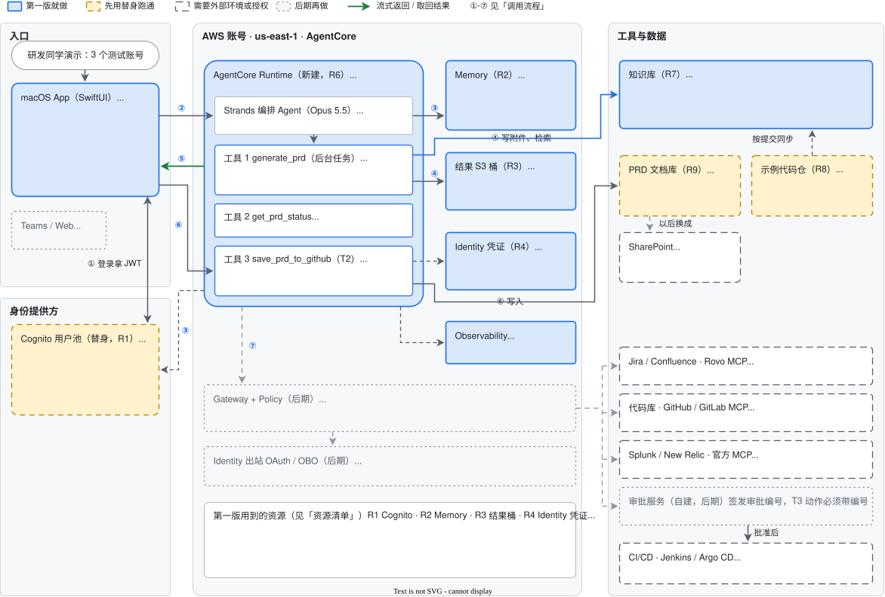

# 研发团队 Agent 第一版骨架：架构说明

> 最后更新: 2026-11-02

本文说明研发团队 Agent 第一版骨架的架构：由哪些组件组成，一次请求怎么走，几项关键设计为什么这样定，以及哪些部分留到后期再做。

**当前状态（2026-11-02）**：示例代码仓已经完成；服务端、App 和云资源正在实现。本文写的是第一版的设计。

## 1. 定位和范围

研发团队 Agent 是研发同学在 Mac 上通过对话使用的助手。下文的「原始方案」指项目开始时的研发团队 Agent 方案文档。按原始方案，它自己只做三样东西：macOS 对话 App、一个 Strands 编排 Agent，以及审批与权限层。具体的能力都做成编排 Agent 可以调用的工具。

第一版先把这套骨架搭起来，只接一个工具：PRD 生成。一次完整的使用过程是：

1. 研发同学在 App 里登录，附上本机文档，和编排 Agent 对话。
2. 编排 Agent 追问需求，问清楚后在后台生成 PRD。
3. 用户确认后，PRD 保存到 PRD 文档库。

App 分三栏：左边是会话列表，中间是对话，右边固定显示「本次任务」（生成进度、PRD 结果、保存前的确认卡片）、「附件」和「我的长期记忆」。

第一版用 3 个测试账号演示，每个人只能看到自己的会话、长期记忆和生成结果。第一版不做的部分见第 7 节。

## 2. 架构图

- **框的颜色**：蓝色实线框是第一版就做的部分。黄色虚线框是第一版先用替身跑通的部分：Cognito 代替公司 IdP，两个 GitHub 私有仓库分别代替 SharePoint 和真实的代码库。白色虚线框需要外部系统的环境或授权。灰色点线框留到后期再做。
- **箭头**：绿色箭头是流式返回或取回结果。虚线箭头是辅助调用（校验 JWT、取令牌、写日志、同步代码）或后期的调用。
- **编号**：①-⑦ 对应第 3 节的调用流程，R1-R9 对应第 5 节的资源清单。

## 3. 调用流程

| 步骤 | 内容 | 第一版 |
| ---- | ---- | ---- |
| ① | App 打开登录页，用授权码 + PKCE 登录，从 Cognito 拿到 JWT | 做 |
| ② | App 用 HTTPS POST 调 Runtime 的 invocations 端点，请求头带 `Authorization: Bearer <JWT>` 和 `X-Amzn-Bedrock-AgentCore-Runtime-Session-Id`。附件放在请求体里：`.md` 原样上传，PDF 先在本机提取文字 | 做 |
| ③ | Runtime 按 Cognito 的发现地址校验 JWT，不通过就拒绝。代码只从 JWT 的 `sub` 取用户 ID，再从 Memory 读出这个会话的历史和这个人的长期记忆 | 做 |
| ④ | 编排 Agent 在对话里追问需求。需求清楚后调用 `generate_prd`，先回复"已开始生成"，生成在后台继续：检索本次附件和示例代码仓同一提交的代码，生成 PRD 并校验，结果写进结果桶里这个人的目录 | 做 |
| ⑤ | App 轮询生成进度，这类请求不经过模型。生成完以后，App 取回 PRD，在本机存一份 | 做 |
| ⑥ | 用户要保存时，App 弹出确认卡片。用户确认后，`save_prd_to_github` 用 Identity 里的令牌把 PRD 写进 PRD 文档库 | 做 |
| ⑦ | Jira、代码库、日志等工具经 Gateway + Policy 调用，以用户本人身份换取下游系统的令牌；T3 动作先过审批服务 | 后期 |

## 4. 关键设计

### 4.1 身份和用户隔离

- **登录**：第一版用 Cognito 用户池代替公司 IdP，关闭自助注册。App client 不带密钥，App 用系统登录窗口 `ASWebAuthenticationSession` 加 PKCE 登录，令牌存在钥匙串里。App 里不放任何 AWS 密钥，这是原始方案的要求。
- **Runtime 认证**：Runtime 的入站认证只能选 JWT 或 SigV4 其中一种。第一版用 JWT，所以 App 不经过 AWS SDK，而是直接用 HTTPS 调 Runtime 的 invocations 端点，带上 Bearer 令牌。
- **用户 ID**：只从校验过的 JWT 的 `sub` 取，不信任请求体里的任何用户字段。会话、长期记忆和生成结果都按这个 ID 分开存放。
- **换成公司 IdP**（Entra 或 Okta）有两种做法：
  - 直接接入：改 Runtime 的 JWT 校验配置和 App 的登录配置。不同 IdP 的令牌用不同的字段标识应用，要按新 IdP 的令牌在 `allowedClients` 和 `allowedAudience` 之间选择。
  - 联邦：让公司 IdP 联邦到 Cognito，Runtime 和 App 的配置不变。
- 换 IdP 以后用户 ID 会变，之前的会话和长期记忆对不上新账号。

### 4.2 后台生成和结果存储

- **生成时长**：一次 PRD 端到端测试共用 527 秒，其中生成约 7.5 分钟。
- **后台任务**：`generate_prd` 用 `bedrock-agentcore` SDK 的 `add_async_task` / `complete_async_task` 做成后台任务。编排 Agent 先回复"已开始生成"，App 之后用 `get_prd_status` 查进度。中途关掉 App 不影响生成。
- **平台限制**（来自 AgentCore 的配额和长时间运行文档，链接见第 9 节）：
  - 同步请求最长 15 分钟，流式连接最长 60 分钟，异步任务最长 8 小时。
  - 会话空闲 15 分钟就会销毁，最长存活 8 小时，销毁后会话里的内容全部清空。
  - 后台任务运行期间，会话处于"忙"状态（`HealthyBusy`），不会被回收。
  - 如果阻塞调用堵住了 `/ping`，会话会在 15 分钟后被终止，所以生成要放到单独的线程或异步方法里。
- **结果存 S3**：因为会话里的内容留不住，生成结果存进专用的 S3 桶，按 `results/<用户 ID>/<会话 ID>/<任务 ID>/` 分目录。App 不直接访问 S3：Runtime 校验 JWT 以后，只读这个人自己目录下的文件。所以不需要给每个用户单独配 S3 权限。
- **Memory 里只记一条短消息**：版本、校验结果和任务 ID，不存 PRD 全文。原因有两个：单条消息最大 100 KB；全文放进对话历史，可能被编排 Agent 当作上下文反复读入。
- **修改 PRD**：用户带上修改意见，整份重新生成，不需要旧的全文。

### 4.3 知识来源和检索

- **两类知识**：会话里附带的本机文档，以及示例代码仓某一次提交的代码。
- **附件**：支持 `.md` 和 PDF。PDF 在 App 里用 macOS 的 PDFKit 提取文字后再上传，表格和图片的版式会丢失；提不出文字的 PDF（比如扫描件）直接拒绝并提示原因。一次最多 20 份，提取后的文字总共不超过 2 MB。
- **附件隔离**：每份附件整份写进知识库的自定义数据源，带上 `task_id` 标签，只有这一次任务检索得到，生成结束后删除。`task_id` 由 Runtime 生成，不用调用方传来的会话 ID。附件由知识库自己切块：如果自己切成很多小块，只要有一块索引卡住，整个任务就会失败。
- **代码**：示例代码仓按提交切块，存进知识库的 S3 数据源。每块都标明仓库、提交、文件和行号，同时生成这次提交的文件清单。PRD 里的代码影响条目引用的文件，必须在这份清单里，否则校验报 `code.path.not_found`。
- **检索条件**：本次任务的附件，或者同一提交的代码，满足其中一个就能检索到。
- **示例代码仓**：一个虚构的管理后台，只能手动逐个建用户，没有 CSV 导入功能。演示时 PRD 讲的就是"新增 CSV 批量导入用户"，所以 PRD 引用的都是要改动或要复用的现有文件。
- **不经 Gateway**：第一版由 Runtime 直接调知识库的 `Retrieve`。Gateway 的知识库目标不接受调用方传过滤条件（实测报错 `cannot set parameter(s): [/retrievalConfiguration]`），而按任务隔离附件，每次检索都要带过滤条件。

### 4.4 Memory

- **短期记忆**：按「用户 + 会话」保存每条消息，保留 30 天。会话列表和隔天接着聊都靠它。保留期可以设成 3-365 天。
- **长期记忆**：开三种策略，分别是用户偏好、语义事实和会话摘要。Memory 在后台从对话里提炼这些记录，新会话开始时，编排 Agent 先读进来。策略也可以在 Memory 建好以后再补加。
- **按人分开**：偏好和事实的命名空间是 `/strategy/{memoryStrategyId}/actor/{actorId}/`，摘要是 `/strategy/{memoryStrategyId}/actor/{actorId}/session/{sessionId}/`。`actorId` 就是 JWT 里的 `sub`，所以 A 的记忆不会出现在 B 的会话里。
- **不经过模型的请求**：App 右栏的「我的长期记忆」由服务端用 `ListMemoryRecords` 按本人的命名空间前缀列出。会话列表和查进度也一样，直接返回，不调用模型。

### 4.5 写入外部系统前要用户确认

- **权限分级**（原始方案）：T0 只读；T1 生成草稿；T2 可撤销的写入，用户在 App 里确认后才执行；T3 高影响动作，先计划、再审批、再执行。
- `generate_prd` 属于 T1，只生成草稿，不写外部系统。`save_prd_to_github` 属于 T2。
- **确认流程**：PRD 生成完以后，App 右栏显示确认卡片。卡片经 Runtime 的流式返回推给 App，用户确认后，编排 Agent 才调用 `save_prd_to_github`。
- **令牌**：用 GitHub 细粒度令牌，只能读写 PRD 文档库的内容。令牌存在 AgentCore Identity 的 API 密钥凭证里，Runtime 运行时用 SDK 的 `requires_api_key` 取出。令牌由管理员生成后存入，不出现在代码和配置里。提交记录的作者都是令牌所属的账号。
- **网络**：Runtime 的网络模式是 `PUBLIC`，要能访问 `api.github.com`。
- **以后换成 SharePoint**：只换掉这个工具，仍然在服务端写入，需要 SharePoint 写权限的授权。

### 4.6 模型

编排 Agent 和 PRD 生成都用 `us.anthropic.claude-opus-5-5` 推理配置。模型 ID 放在环境变量里，换模型只改配置、重新部署，不用改代码。

## 5. 资源清单

| 编号 | 资源 | 要点 |
| ---- | ---- | ---- |
| R1 | Cognito 用户池、App client、托管登录域名 | 关闭自助注册；App client 不带密钥，只开授权码 + PKCE；回调地址 `rdteamagent://callback` |
| R2 | AgentCore Memory | 会话记录保留 30 天；用户偏好、语义事实、会话摘要三种长期策略，命名空间都带 `{actorId}` |
| R3 | 结果 S3 桶 `rd-team-agent-results-<账号 ID>-<区域>` | 公共访问阻止全开，禁用 ACL，SSE-S3 加密，不开版本控制；第一版不设生命周期规则 |
| R4 | AgentCore Identity API 密钥凭证 | 存 GitHub 细粒度令牌，只能读写 PRD 文档库的内容 |
| R5 | Runtime 的 IAM 角色 | 只给需要的权限：调用模型推理配置；知识库检索，以及任务附件的写入和删除；R3 里 `results/*` 的读写；R2 的读写；读 R4；写日志和链路追踪。注意：直接写入文档的 `IngestKnowledgeBaseDocuments` 还要求 `bedrock:StartIngestionJob` 权限，这是实测发现的 |
| R6 | AgentCore Runtime | JWT 入站认证（R1 的发现地址 + `allowedClients`），网络模式 `PUBLIC`，把 `Authorization` 头转给代码 |
| R7 | 知识库 | 两个数据源：S3 数据源放示例代码的切块，用 `project_id` 区分项目；自定义数据源放任务附件 |
| R8 | GitHub 私有仓库 `rd-team-agent-sample-app` | 示例代码仓 |
| R9 | GitHub 私有仓库 `rd-team-agent-prds` | PRD 文档库，演示中代替 SharePoint |

## 6. 代码在哪里

- **`rd-team-agent` 仓库**：
  - `server/`：PRD 生成和校验的代码，附 172 个测试；编排 Agent 和 3 个工具正在实现。
  - `app/`：SwiftUI 对话 App，正在实现。
  - `docs/`：本文、架构图，以及生成架构图的脚本 `docs/diagram/gen_arch.py`。脚本会自动计算坐标，并检查框重叠、连线穿过别的框和文字溢出。
- **`rd-team-agent-sample-app` 仓库**：示例代码仓，前端是 React + TypeScript，后端是 Python FastAPI + SQLite，都附带测试。

## 7. 后期再做

- **Gateway + Policy**：接第一个外部系统时再建。所有 MCP 工具统一挂在 Gateway 后面，Policy 在每次工具调用前决定允许还是拒绝。原始方案建议 Policy 先用 `LOG_ONLY` 跑一两周再切到 `ENFORCE`，生产部署类工具在 MVP 阶段直接用 Policy 禁止。
- **Identity 出站 OAuth / OBO**：以用户本人身份换取 Jira、GitHub 等系统的令牌。首次授权时，把同意链接弹回 App。
- **审批服务**：自建，签发审批编号。T3 执行类工具必须带上审批编号，不能由模型自己声明"已批准"。
- **外部系统**：
  - Jira / Confluence：Rovo MCP 只支持 Atlassian Cloud；如果是 Data Center，要用 Gateway 的 OpenAPI 目标包一层 REST 接口。
  - 代码库：GitHub / GitLab 官方 MCP。
  - Splunk / New Relic：官方 MCP。
  - CI/CD：用 Jenkins、Argo CD、GitHub Actions 还是 GitLab CI 还没定，这决定部署工具怎么封装。
- **写回 SharePoint**：替换 `save_prd_to_github`，见 4.5。
- **公司 IdP**：替换 Cognito，见 4.1。
- **Evaluations、Teams / Web 入口**。

## 8. 和原始方案的不同

1. **知识库的接法**：原始方案的架构草图里，知识库挂在 Gateway 后面。第一版由 Runtime 直接调 `Retrieve`，原因见 4.3 最后一条。
2. **确认卡片的路径**：原始方案的草图里，确认卡片从 Gateway 指向 App。原始方案正文写的是用 Strands interrupts 在工具执行前暂停、等人确认，所以第一版让确认卡片经 Runtime 的流式返回推给 App。
3. **第一版新增的组件**：结果 S3 桶（R3）、Identity 凭证（R4）、示例代码仓（R8）和 PRD 文档库（R9）是第一版加的，原始方案里没有。

## 9. 参考资料

- [AgentCore 配额](https://docs.aws.amazon.com/bedrock-agentcore/latest/devguide/bedrock-agentcore-limits.html)：请求时长、会话生命周期、Memory 单条消息大小。
- [AgentCore Runtime 长时间运行](https://docs.aws.amazon.com/bedrock-agentcore/latest/devguide/runtime-long-run.html)：后台任务、`/ping` 和 `HealthyBusy`。
- [AgentCore Memory 的组织方式](https://docs.aws.amazon.com/bedrock-agentcore/latest/devguide/memory-organization.html)：命名空间和占位符。
- [Introducing Amazon Bedrock AgentCore Identity](https://aws.amazon.com/blogs/machine-learning/introducing-amazon-bedrock-agentcore-identity-securing-agentic-ai-at-scale/)：Runtime 的 JWT 入站配置示例。
